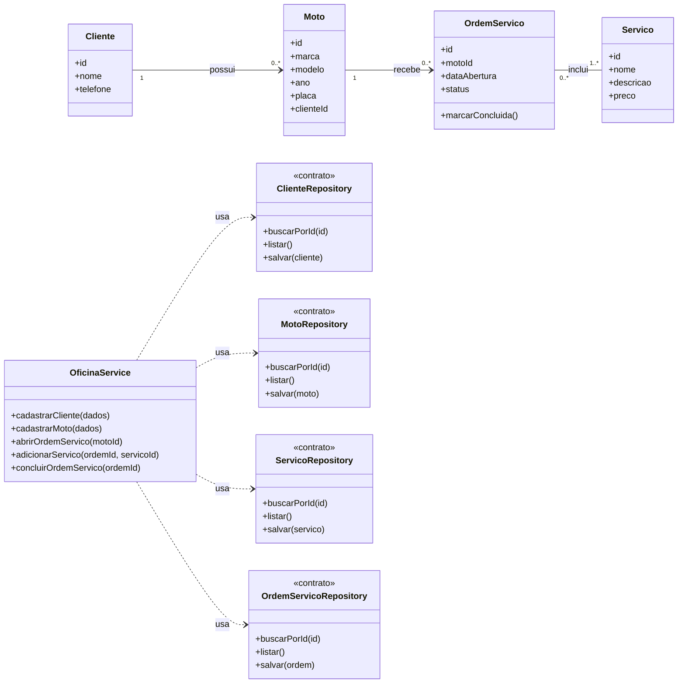

# Modelagem — Projeto 1

**Aluno(a):** Seu Nome Completo  
**Domínio:** Gerenciamento de uma oficina de motos

## 1. O domínio

A oficina cadastra clientes e suas motos, registra os serviços oferecidos e gerencia ordens de serviço. Cada ordem de serviço está associada a uma moto e pode conter um ou mais serviços realizados durante a manutenção.

## 2. Entidades

| Entidade | Atributos | Relacionamentos |
|---|---|---|
| Cliente | id, nome, telefone | possui várias motos |
| Moto | id, marca, modelo, ano, placa, clienteId | pertence a um cliente e aparece em várias ordens de serviço |
| Serviço | id, nome, descricao, preco | aparece em várias ordens de serviço |
| OrdemServico | id, motoId, dataAbertura, status | pertence a uma moto e contém um ou mais serviços |

## 3. Diagrama de classes

## 4. Responsabilidades

| Classe | Papel | Único motivo para mudar |
|---|---|---|
| Cliente, Moto, Servico, OrdemServico | entidades | alteração das regras ou dos dados próprios de cada entidade |
| OficinaService | regras de negócio | alteração do processo de cadastro e gerenciamento das ordens de serviço |
| ClienteRepository, MotoRepository, ServicoRepository, OrdemServicoRepository | acesso aos dados | alteração da forma de armazenamento, como memória ou SQLite |
| OrdemServico | controle do estado da ordem | alteração das regras de transição de status, como de aberta para concluída |

## 5. Onde apliquei SRP e DIP

- **SRP (Princípio da Responsabilidade Única):** cada classe possui uma responsabilidade específica. As entidades representam os dados e as regras próprias do domínio; os repositories cuidam do acesso aos dados; e o OficinaService coordena as operações de negócio.

- **DIP (Princípio da Inversão de Dependência):** o OficinaService depende dos contratos dos repositories, e não de implementações específicas.

